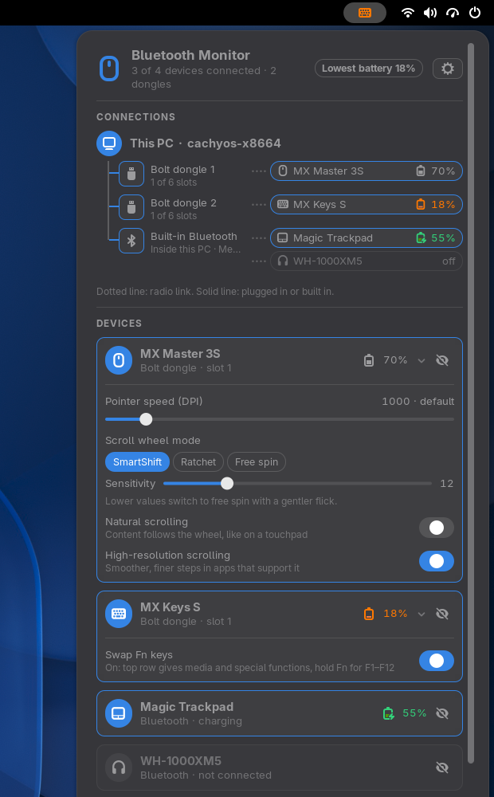

# Bluetooth Monitor for GNOME

**Every wireless device at a glance: battery and connection, in one picture.**

Bluetooth Monitor is a GNOME Shell extension (GNOME 51) for mice, keyboards, trackpads, earphones and game controllers. It shows how full each battery is and how each device reaches your PC, over Bluetooth or through a Logitech USB dongle (Unifying, Bolt, Nano, Lightspeed). It is the GNOME port of the Omarchy bar widget [Bluetooth Monitor](https://github.com/uBruckhaus/omarchy-bluetooth-monitor) and uses the same Python helper.



- **Connection map.** A tree of this PC, every dongle and Bluetooth adapter (solid line: plugged in or built in) and the devices on each (dotted line: radio), with their battery. You see which dongle a device needs, which dongle has free slots and whether your Bluetooth is built into the PC or a USB stick.
- **A top bar icon that stays quiet until it matters.** Green while every battery is fine, **orange** when one runs low, **red** when one is critical, and it turns into the device that needs charging: keyboard, trackpad, earphones, controller (mouse on a tie). Dim while no device is connected. Left click opens the panel, right click refreshes.
- **You pick what is listed.** Every device is shown, switched on or off; hide the ones you don't care about with the eye on their card. A hidden device also leaves the bar icon, so it never warns. The eye button in the header shows the hidden ones again (with how many there are), dimmed, so you can bring them back.
- **Bluetooth page** (the Bluetooth button): switch Bluetooth on or off, scan for new devices, pair, connect, disconnect and forget (Forget asks twice). It scans only while the page is open, through `bluetoothctl scan on`, which BlueZ stops as soon as the page or the panel closes. A headset or speaker that connects becomes the audio output.
- **Logitech settings without Solaar or Logi Options**, straight over Logitech's HID++ protocol, when the device supports them: pointer speed (DPI), SmartShift / ratchet / free-spin scroll wheel and its sensitivity, natural and high-resolution scrolling, Fn-key swap. Changed settings are written again when a device reconnects.
- **Settings** (the gear): low and critical battery levels for the icon (25 % and 10 % by default), whether other Bluetooth devices are listed, and receiver access. Backspace goes back to the device list.

English only.

## Install

Requires GNOME Shell 51, `python3` (standard library only), `bluetoothctl` (BlueZ), `upower`, `rfkill` and, for the audio switch, `pactl` (PipeWire's PulseAudio server).

```sh
tools/build.sh
gnome-extensions install --force dist/bluetooth-monitor@ubruckhaus.github.io.shell-extension.zip
```

Log out and back in, then `gnome-extensions enable bluetooth-monitor@ubruckhaus.github.io`.

## Permissions (Logitech receivers only)

**Allow access** runs `scripts/allow-access.sh` through `pkexec`, so GNOME asks for your password once. The script writes one file, `/etc/udev/rules.d/42-logitech-hidpp-uaccess.rules`, and reloads udev. The rule tags `hidraw` nodes of USB devices with Logitech's vendor id (`046d`) and Logitech Bluetooth devices with `uaccess`, which gives the user logged in at the seat (and nobody else) read and write access to them while logged in. It is the same scope as the rule Solaar installs and works on any systemd-based distribution. Nothing runs as root at any other time; the extension never asks again unless you remove the rule.

Write access to a receiver is what lets the extension change DPI or SmartShift; like Solaar, it would in principle also allow a firmware update, which this extension never does. If you only want battery levels from Bluetooth devices, skip the button: everything else works without it.

To revoke the access:

```sh
sudo rm /etc/udev/rules.d/42-logitech-hidpp-uaccess.rules
sudo udevadm control --reload-rules && sudo udevadm trigger --subsystem-match=hidraw
```

## How it works

- `scripts/bluetooth-monitor.py` (Python standard library) runs while the extension is enabled. It talks HID++ to Logitech receivers and devices over `/dev/hidraw` (pairing slots, names, battery, DPI, SmartShift, wheel and Fn settings) and reads other devices' batteries from `upower --dump`, and connected Bluetooth peripherals without a battery reading from BlueZ (`busctl --system call org.bluez / … GetManagedObjects`, read only, output capped). A `upower --monitor` child, tied to the helper's lifetime, triggers a rescan when a device connects or a battery changes; otherwise it checks every 60 s (10 s while the panel is open). It takes JSON commands on stdin (open, closed, refresh, options, set) and streams JSON snapshots on stdout.
- The Bluetooth page reads BlueZ through GNOME's own GnomeBluetooth library, like the Bluetooth quick setting. Every change goes through a helper with a fixed argv and a checked address: `scripts/bt-device.sh` (pair, connect, disconnect, forget with `bluetoothctl`, each step with a time limit), `scripts/bt-power.sh` (the rfkill soft block, which GNOME's Bluetooth switch follows and which survives a reboot) and `scripts/audio-default.py` (sets the new headset's PipeWire sink as default with `pactl` and moves playing streams to it).
- The Bluetooth adapter counts as built in when it is not on USB, sits on a fixed USB port, or comes from a maker of internal Wi-Fi/Bluetooth cards (Intel, MediaTek, AzureWave, Foxconn, Qualcomm, Lite-On); otherwise it is shown as a USB Bluetooth stick.
- Device names come from the devices themselves; they are shown as plain text with markup and control characters removed.

**Privacy:** no network requests. It reads sysfs, `/dev/hidraw` of Logitech devices, UPower and BlueZ's device list, and writes only `~/.config/bluetooth-monitor/settings.json` (the Logitech settings you changed) and its GSettings (`org.gnome.shell.extensions.bluetooth-monitor`: warning levels, hidden devices, other devices on or off).

## Differences from the Omarchy widget

- GNOME Shell extension instead of a Quickshell bar widget; settings in GSettings instead of `shell.json`; no language setting and no plugin information page.
- Omarchy's `omarchy-bluetooth-device`, `omarchy-bluetooth-power` and `omarchy-audio-output-set-default` are replaced by the small helpers above, which do the same steps.
- The helper reads its stdin commands with its own line buffer: two commands arriving together (for example "options" and "open" at start) were handled late before.

## Remove

```sh
gnome-extensions uninstall bluetooth-monitor@ubruckhaus.github.io
rm -rf ~/.config/bluetooth-monitor
```

and the udev rule as shown above, if you allowed access.

## Development

```sh
python3 -m unittest discover -s tests
python3 bluetooth-monitor@ubruckhaus.github.io/scripts/bluetooth-monitor.py --once | python3 -m json.tool
tools/headless-test.sh panel     # isolated headless GNOME Shell; screenshots in dist/screenshots/
```

The headless test never touches a real device: `bluetoothctl`, `rfkill`, `pactl` and `pkexec` are logging stand-ins from `tools/mock-bin`, the Python helper is replaced by a fake that streams fixed devices, and the Bluetooth page gets fake BlueZ devices. It checks every action's command line, that the scan stops when the panel closes, and that the helper stops with the extension.

Licensed under [MIT](LICENSE).
